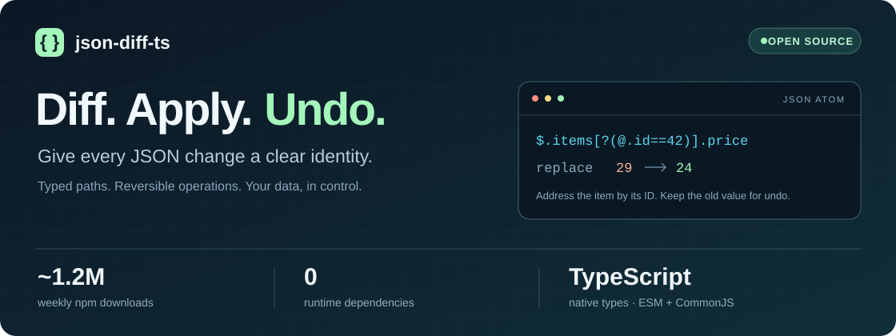

# json-diff-ts



[](https://www.npmjs.com/package/json-diff-ts) [](https://www.npmjs.com/package/json-diff-ts) [](https://github.com/ltwlf/json-diff-ts/actions/workflows/ci.yml) [](https://codecov.io/gh/ltwlf/json-diff-ts) [](LICENSE)

**Turn JSON changes into something you can inspect, apply, and undo.** A TypeScript toolkit for meaningful diffs, stable array identity, and reversible [JSON Atom](https://github.com/ltwlf/json-atom-format) operations. Zero runtime dependencies. ESM and CommonJS included.

**Around 1.2 million npm downloads a week.** [npm recorded 1,196,776 downloads for November 7–13, 2026](https://api.npmjs.org/downloads/point/2026-11-07:2026-11-13/json-diff-ts); the badge above updates automatically.

Created by **[Christian Glessner](https://www.linkedin.com/in/christian-glessner/)** · [Support the project](https://buymeacoffee.com/leitwolf)

[Quick start](#quick-start) · [Regex skipping](#skip-the-noise) · [JSON Atom API](#json-atom-api) · [Python & specification](#one-format-two-languages) · [Migrate from v4](#migration-from-v4)

## Installation

```sh
npm install json-diff-ts
```

```typescript
// ESM / TypeScript
import { diffAtom, applyAtom, revertAtom } from 'json-diff-ts';

// CommonJS
const { diffAtom, applyAtom, revertAtom } = require('json-diff-ts');
```

Maintaining a v4 application? `npm install json-diff-ts@legacy-v4` installs the v4 maintenance release. npm `latest` follows v5.

## Quick Start

A price changes. The item keeps its identity. The old value stays available for undo.

```typescript
import { diffAtom, applyAtom, revertAtom } from 'json-diff-ts';

const before = { items: [{ id: 42, name: 'Widget', price: 29 }] };
const after  = { items: [{ id: 42, name: 'Widget', price: 24 }] };

const atom = diffAtom(before, after, {
  arrayIdentityKeys: { items: 'id' },
});

// Mutating APIs: clone first when you want to preserve the input.
const updated  = applyAtom(structuredClone(before), atom);
const restored = revertAtom(structuredClone(updated), atom);
// updated matches after; restored matches before.
```

The result is plain JSON, ready to store or send:

```json
{
  "format": "json-atom",
  "version": 1,
  "operations": [
    {
      "op": "replace",
      "path": "$.items[?(@.id==42)].price",
      "value": 24,
      "oldValue": 29
    }
  ]
}
```

## Skip the noise

**New in 5.1:** mix string paths and regular expressions in `keysToSkip`. Focus a diff on changes that matter to your application.

```typescript
import { diffAtom } from 'json-diff-ts';

const before = { user: { name: 'Alice', updatedAt: '09:00', internal: 'a' } };
const after  = { user: { name: 'Anna',  updatedAt: '09:01', internal: 'b' } };

const atom = diffAtom(before, after, {
  keysToSkip: [/\.updatedAt$/, 'user.internal'],
});
// Only $.user.name changes: Alice → Anna.
```

Works with `diff` and `diffAtom`. Global and sticky regexes are evaluated independently for each path without changing your regex's `lastIndex`. Use [`keysToInclude`](#include-only-selected-paths) to select fields; skips take precedence.

Selection controls which paths are compared, **not payload redaction**. Adding or replacing an entire object retains its complete value.

## Build with changes

| You are building… | Start here |
| --- | --- |
| Undo / redo | `diffAtom` → `applyAtom` → `revertAtom` |
| Audit logs and state history | Store atoms with `oldValue`; attach actor and timestamp extensions |
| API payload or configuration diffs | `keysToInclude`, string paths, and regex `keysToSkip` |
| Changes to keyed collections | `arrayIdentityKeys: { items: 'id' }` |
| A readable comparison UI | [`compare` and comparison serialization](#comparison-serialization) |
| A TypeScript + Python system | [Exchange JSON Atom documents](#one-format-two-languages) |

### Identity that survives a reorder

`$.items[?(@.id==42)].price` selects the item with numeric ID `42`, wherever it sits in the array. An index path such as `$.items[0].price` selects the item currently at position zero.

Choose keyed identity when membership and field values matter. **Keyed diffs preserve the order of existing elements and do not encode pure reordering.** Use index-based diffing when exact array order is part of the state you need to reproduce. Identity keys must be unique, and numeric `42` is distinct from string `'42'`.

Stable identity is useful for replay and synchronization, but it does not provide conflict resolution: the target must still meet each operation's preconditions.

## One format, two languages

| Project | Role | Get started |
| --- | --- | --- |
| **[json-diff-ts](https://github.com/ltwlf/json-diff-ts)** | TypeScript / JavaScript implementation | `npm install json-diff-ts` |
| **[json-atom-py](https://github.com/ltwlf/json-atom-py)** | Python implementation | `pip install json-atom` |
| **[JSON Atom Format](https://github.com/ltwlf/json-atom-format)** | Wire format, path grammar, and shared fixtures | [Read the specification](https://github.com/ltwlf/json-atom-format/blob/main/spec/v0.md) |

The repository names, package versions, and wire-format version are separate: a JSON Atom document uses `"format": "json-atom"` and `"version": 1`. The specification's current draft lives in `spec/v0.md`.

Diff options are local API choices; consumers only need the resulting atom. A Python consumer can apply the JSON produced by the quick start above:

```python
import copy
import json
from json_atom import apply_delta, revert_delta

# `payload` is JSON.stringify(atom) from the TypeScript example.
atom = json.loads(payload)
before = {"items": [{"id": 42, "name": "Widget", "price": 29}]}
updated = apply_delta(copy.deepcopy(before), atom)
restored = revert_delta(copy.deepcopy(updated), atom)
assert updated["items"][0]["price"] == 24
assert restored == before
```

[Shared conformance fixtures](https://github.com/ltwlf/json-atom-format/tree/main/fixtures) exercise all five operation types. [Run the cross-language checks](docs/interop.md) for the tested source revisions and compatibility boundaries. JavaScript and Python have different numeric precision; use string identity keys for integers outside JavaScript's safe integer range.

## What is JSON Atom?

[JSON Atom](https://github.com/ltwlf/json-atom-format) is a specification for representing atomic changes to JSON documents. json-diff-ts is the originating implementation from which the spec was derived.

An atom is a self-describing JSON document you can store, transmit, and consume in any language:

- **Five operations** -- `add`, `remove`, `replace`, `move`, and `copy`. `diffAtom` produces the first three; the executor also accepts explicit move/copy operations.
- **JSONPath-based paths** -- `$.items[?(@.id==1)].name` identifies elements by key, not index.
- **Reversible diffs by default** -- `diffAtom` includes `oldValue` for replacements and removals. Reversible copy operations also carry the copied `value`.
- **Self-identifying** -- the `format` field makes atoms discoverable without external context.
- **Extension-friendly** -- unknown properties are preserved; `x_`-prefixed properties are future-safe.

### JSON Atom vs JSON Patch (RFC 6902)

JSON Patch applies an ordered list of operations against a document using JSON Pointer paths such as `/items/0`. Those positional paths work when operations are applied to the expected state. Independently reordering a target array can change which element a stored path addresses.

JSON Atom additionally supports typed identity filters such as `$.items[?(@.id==42)]`. This lets an operation address an item by its identity while retaining index paths when positional semantics are needed. Neither format is a conflict-resolution protocol.

| | JSON Atom | JSON Patch (RFC 6902) |
| --- | --- | --- |
| Paths | Constrained JSONPath, including typed key filters | JSON Pointer |
| Array targeting | By index, identity key, or primitive value | By index |
| Undo information | `oldValue` on remove/replace; `value` on reversible copy | No standard old-value field |
| Document | Self-identifying `format` / `version` envelope | Array of operations |
| Operations | `add`, `remove`, `replace`, `move`, `copy` | Those five plus `test` |
| Specification | [JSON Atom draft](https://github.com/ltwlf/json-atom-format) | [RFC 6902](https://www.rfc-editor.org/rfc/rfc6902) |

---

## JSON Atom API

### `diffAtom` -- Compute an Atom

```typescript
const atom = diffAtom(
  { user: { name: 'Alice', role: 'viewer' } },
  { user: { name: 'Alice', role: 'admin' } }
);
// atom.operations → [{ op: 'replace', path: '$.user.role', value: 'admin', oldValue: 'viewer' }]
```

#### Keyed Arrays

Match array elements by identity key. Filter paths use canonical typed literals per the spec:

```typescript
const atom = diffAtom(
  { users: [{ id: 1, role: 'viewer' }, { id: 2, role: 'editor' }] },
  { users: [{ id: 1, role: 'admin' },  { id: 2, role: 'editor' }] },
  { arrayIdentityKeys: { users: 'id' } }
);
// atom.operations → [{ op: 'replace', path: '$.users[?(@.id==1)].role', value: 'admin', oldValue: 'viewer' }]
```

#### Non-reversible Mode

Omit `oldValue` fields when you don't need undo:

```typescript
const atom = diffAtom(source, target, { reversible: false });
```

### `applyAtom` -- Apply an Atom

Applies operations sequentially. Always use the return value (required for root-level replacements):

```typescript
const result = applyAtom(structuredClone(source), atom);
```

### `revertAtom` -- Revert an Atom

Computes the inverse and applies it. Requires `oldValue` on all `replace` and `remove` operations:

```typescript
const original = revertAtom(structuredClone(target), atom);
```

### `invertAtom` -- Compute the Inverse

Returns a new atom that undoes the original (spec Section 9.2):

```typescript
const inverse = invertAtom(atom);
// add ↔ remove, replace swaps value/oldValue, order reversed
```

### `validateAtom` -- Validate Structure

```typescript
const { valid, errors } = validateAtom(maybeAtom);
```

### API Reference

| Function | Signature | Description |
| --- | --- | --- |
| `diffAtom` | `(oldObj, newObj, options?) => IJsonAtom` | Compute a canonical JSON Atom |
| `applyAtom` | `(obj, atom) => any` | Apply an atom sequentially. Returns the result |
| `revertAtom` | `(obj, atom) => any` | Revert a reversible atom |
| `invertAtom` | `(atom) => IJsonAtom` | Compute the inverse atom |
| `validateAtom` | `(atom) => { valid, errors }` | Structural validation |
| `toAtom` | `(changeset, options?) => IJsonAtom` | Bridge: v4 changeset to JSON Atom |
| `fromAtom` | `(atom) => IAtomicChange[]` | Bridge: JSON Atom to v4 atomic changes |
| `squashAtoms` | `(source, atoms, options?) => IJsonAtom` | Compact multiple atoms into one net-effect atom |
| `atomMap` | `(atom, fn) => IJsonAtom` | Transform each operation in an atom |
| `atomStamp` | `(atom, extensions) => IJsonAtom` | Set extension properties on all operations |
| `atomGroupBy` | `(atom, keyFn) => Record<string, IJsonAtom>` | Group operations into sub-atoms |
| `operationSpecDict` | `(op) => IAtomOperation` | Strip extension properties from operation |
| `operationExtensions` | `(op) => Record<string, any>` | Get extension properties from operation |
| `atomSpecDict` | `(atom) => IJsonAtom` | Strip all extensions from atom |
| `atomExtensions` | `(atom) => Record<string, any>` | Get envelope extensions from atom |
| `leafProperty` | `(op) => string \| null` | Terminal property name from operation path |

### AtomOptions

Extends the base `Options` interface:

```typescript
interface AtomOptions extends Options {
  reversible?: boolean;       // Include oldValue for undo. Default: true
  arrayIdentityKeys?: Record<string, string | FunctionKey>;
  keysToSkip?: readonly (string | RegExp)[];
  keysToInclude?: readonly string[];
}
```

### Include only selected paths

`diff` and `diffAtom` accept `keysToInclude` to compare selected fields or entire subtrees. Paths use dot notation and omit array indices and identity values, so one entry selects the field in every array element.

```typescript
const atom = diffAtom(oldOrder, newOrder, {
  arrayIdentityKeys: { positions: 'id', 'positions.deliveries': 'id' },
  keysToInclude: ['positions.quantity', 'positions.deliveries'],
  keysToSkip: ['positions.deliveries.internalNotes'],
});
```

Each included path selects itself and its descendants. Unrelated branches are skipped before their values are read. `keysToSkip` takes precedence. Omit `keysToInclude` to compare everything; pass `[]` to produce no changes.

Structural changes (adding, removing, or replacing an entire ancestor object or array element) retain the complete value, as with `keysToSkip`. This keeps operations applicable and reversible, including the identity fields needed to locate new array elements. Selection controls traversal of existing branches; it does not redact operation payloads.

### Atom Workflow Helpers

Transform, inspect, and compact atoms for workflow automation.

#### `squashAtoms` -- Compact Multiple Atoms

Combine a sequence of atoms into a single net-effect atom. Useful for compacting audit logs or collapsing undo history:

```typescript
import { diffAtom, applyAtom, squashAtoms } from 'json-diff-ts';

const source = { name: 'Alice', role: 'viewer' };
const d1 = diffAtom(source, { name: 'Bob', role: 'viewer' });
const d2 = diffAtom({ name: 'Bob', role: 'viewer' }, { name: 'Bob', role: 'admin' });

const squashed = squashAtoms(source, [d1, d2]);
// squashed.operations => [
//   { op: 'replace', path: '$.name', value: 'Bob', oldValue: 'Alice' },
//   { op: 'replace', path: '$.role', value: 'admin', oldValue: 'viewer' }
// ]

// Verify: applying the squashed atom equals applying both sequentially
const result = applyAtom(structuredClone(source), squashed);
// result => { name: 'Bob', role: 'admin' }
```

Options: `reversible`, `arrayIdentityKeys`, `target` (pre-computed final state), `verifyTarget` (default: true).

#### `atomMap` / `atomStamp` / `atomGroupBy` -- Atom Transformations

All transforms are immutable — they return new atoms without modifying the original:

```typescript
import { diffAtom, atomMap, atomStamp, atomGroupBy } from 'json-diff-ts';

const atom = diffAtom(
  { name: 'Alice', age: 30, role: 'viewer' },
  { name: 'Bob', age: 31, status: 'active' }
);

// Stamp metadata onto every operation
const stamped = atomStamp(atom, { x_author: 'system', x_ts: Date.now() });

// Transform operations
const prefixed = atomMap(atom, (op) => ({
  ...op,
  path: op.path.replace('$', '$.data'),
}));

// Group by operation type
const groups = atomGroupBy(atom, (op) => op.op);
// groups => { replace: IJsonAtom, add: IJsonAtom, remove: IJsonAtom }
```

#### `operationSpecDict` / `atomSpecDict` -- Spec Introspection

Separate spec-defined fields from extension properties:

```typescript
import { operationSpecDict, operationExtensions, atomSpecDict } from 'json-diff-ts';

const op = { op: 'replace', path: '$.name', value: 'Bob', x_author: 'system' };
operationSpecDict(op);    // { op: 'replace', path: '$.name', value: 'Bob' }
operationExtensions(op);  // { x_author: 'system' }

// Strip all extensions from an atom
const clean = atomSpecDict(atom);
```

#### `leafProperty` -- Path Introspection

Extract the terminal property name from an operation's path:

```typescript
import { leafProperty } from 'json-diff-ts';

leafProperty({ op: 'replace', path: '$.user.name' });          // 'name'
leafProperty({ op: 'add', path: '$.items[?(@.id==1)]' });      // null (filter)
leafProperty({ op: 'replace', path: '$' });                     // null (root)
```

---

## Comparison Serialization

Serialize enriched comparison trees to plain objects or flat change lists.

```typescript
import { compare, comparisonToDict, comparisonToFlatList } from 'json-diff-ts';

const result = compare(
  { name: 'Alice', age: 30, role: 'viewer' },
  { name: 'Bob', age: 30, status: 'active' }
);

// Recursive plain object
const dict = comparisonToDict(result);
// {
//   type: 'CONTAINER',
//   value: {
//     name: { type: 'UPDATE', value: 'Bob', oldValue: 'Alice' },
//     age: { type: 'UNCHANGED', value: 30 },
//     role: { type: 'REMOVE', oldValue: 'viewer' },
//     status: { type: 'ADD', value: 'active' }
//   }
// }

// Flat list of leaf changes with paths
const flat = comparisonToFlatList(result);
// [
//   { path: '$.name', type: 'UPDATE', value: 'Bob', oldValue: 'Alice' },
//   { path: '$.role', type: 'REMOVE', oldValue: 'viewer' },
//   { path: '$.status', type: 'ADD', value: 'active' }
// ]

// Include unchanged entries
const all = comparisonToFlatList(result, { includeUnchanged: true });
```

---

## Practical Examples

### Audit Log

Store every change to a document as a reversible atom. Each entry records who changed what, when, and can be replayed or reverted independently -- a complete JSON change tracking system:

```typescript
import { diffAtom, applyAtom, revertAtom, IJsonAtom } from 'json-diff-ts';

interface AuditEntry {
  timestamp: string;
  userId: string;
  atom: IJsonAtom;
}

const auditLog: AuditEntry[] = [];
let doc = {
  title: 'Project Plan',
  status: 'draft',
  items: [
    { id: 1, task: 'Design', done: false },
    { id: 2, task: 'Build', done: false },
  ],
};

function updateDocument(newDoc: typeof doc, userId: string) {
  const atom = diffAtom(doc, newDoc, {
    arrayIdentityKeys: { items: 'id' },
  });

  if (atom.operations.length > 0) {
    auditLog.push({ timestamp: new Date().toISOString(), userId, atom });
    doc = applyAtom(structuredClone(doc), atom);
  }

  return doc;
}

// Revert the last change
function undo(): typeof doc {
  const last = auditLog.pop();
  if (!last) return doc;
  doc = revertAtom(structuredClone(doc), last.atom);
  return doc;
}

// Example usage:
updateDocument(
  { ...doc, status: 'active', items: [{ id: 1, task: 'Design', done: true }, ...doc.items.slice(1)] },
  'alice'
);
// auditLog[0].atom.operations =>
// [
//   { op: 'replace', path: '$.status', value: 'active', oldValue: 'draft' },
//   { op: 'replace', path: '$.items[?(@.id==1)].done', value: true, oldValue: false }
// ]
```

Because every atom is self-describing JSON, your audit log is queryable, storable in any database, and readable from any language.

### Undo / Redo Stack

Build undo/redo for any JSON state object. Atoms are small (only changed fields), reversible, and serializable:

```typescript
import { diffAtom, applyAtom, revertAtom, IJsonAtom } from 'json-diff-ts';

class UndoManager<T extends object> {
  private undoStack: IJsonAtom[] = [];
  private redoStack: IJsonAtom[] = [];

  constructor(private state: T) {}

  apply(newState: T): T {
    const atom = diffAtom(this.state, newState);
    if (atom.operations.length === 0) return this.state;
    this.undoStack.push(atom);
    this.redoStack = [];
    this.state = applyAtom(structuredClone(this.state), atom);
    return this.state;
  }

  undo(): T {
    const atom = this.undoStack.pop();
    if (!atom) return this.state;
    this.redoStack.push(atom);
    this.state = revertAtom(structuredClone(this.state), atom);
    return this.state;
  }

  redo(): T {
    const atom = this.redoStack.pop();
    if (!atom) return this.state;
    this.undoStack.push(atom);
    this.state = applyAtom(structuredClone(this.state), atom);
    return this.state;
  }
}
```

### Data Synchronization

Send only what changed between client and server. Atoms are compact -- a single field change in a 10KB document produces a few bytes of atom, making state synchronization efficient over the wire:

```typescript
import { diffAtom, applyAtom, validateAtom } from 'json-diff-ts';

// Client side: compute and send atom
const atom = diffAtom(localState, updatedState, {
  arrayIdentityKeys: { records: 'id' },
});
await fetch('/api/sync', {
  method: 'POST',
  body: JSON.stringify(atom),
});

// Server side: validate and apply
const result = validateAtom(req.body);
if (!result.valid) return res.status(400).json(result.errors);
// ⚠️ In production, sanitize paths/values to prevent prototype pollution
//    (e.g. reject paths containing "__proto__" or "constructor")
currentState = applyAtom(structuredClone(currentState), req.body);
```

---

## Bridge: v4 Changeset <-> JSON Atom

Convert between the legacy internal format and JSON Atom:

```typescript
import { diff, toAtom, fromAtom, unatomizeChangeset } from 'json-diff-ts';

// v4 changeset → JSON Atom
const changeset = diff(source, target, { arrayIdentityKeys: { items: 'id' } });
const atom = toAtom(changeset);

// JSON Atom → v4 atomic changes
const atoms = fromAtom(atom);

// v4 atomic changes → hierarchical changeset (if needed)
const cs = unatomizeChangeset(atoms);
```

**Note:** `toAtom` is a best-effort bridge. Filter literals are always string-quoted (e.g., `[?(@.id=='42')]` instead of canonical `[?(@.id==42)]`). Use `diffAtom()` for fully canonical output.

---

## Legacy Changeset API (v4 Compatibility)

All v4 APIs remain fully supported. Existing code continues to work without changes. For new projects, prefer the JSON Atom API above.

### `diff`

Generates a hierarchical changeset between two objects:

```typescript
import { diff } from 'json-diff-ts';

const oldData = {
  location: 'Tatooine',
  characters: [
    { id: 'LUKE', name: 'Luke Skywalker', role: 'Farm Boy' },
    { id: 'LEIA', name: 'Princess Leia', role: 'Prisoner' }
  ],
};

const newData = {
  location: 'Yavin Base',
  characters: [
    { id: 'LUKE', name: 'Luke Skywalker', role: 'Pilot', rank: 'Commander' },
    { id: 'HAN', name: 'Han Solo', role: 'Smuggler' }
  ],
};

const changes = diff(oldData, newData, { arrayIdentityKeys: { characters: 'id' } });
```

### `applyChangeset` and `revertChangeset`

```typescript
import { applyChangeset, revertChangeset } from 'json-diff-ts';

const updated = applyChangeset(structuredClone(oldData), changes);
const reverted = revertChangeset(structuredClone(newData), changes);
```

### `atomizeChangeset` and `unatomizeChangeset`

Flatten a hierarchical changeset into atomic changes addressable by JSONPath, or reconstruct the hierarchy:

```typescript
import { atomizeChangeset, unatomizeChangeset } from 'json-diff-ts';

const atoms = atomizeChangeset(changes);
// [
//   { type: 'UPDATE', key: 'location', value: 'Yavin Base', oldValue: 'Tatooine',
//     path: '$.location', valueType: 'String' },
//   { type: 'ADD', key: 'rank', value: 'Commander',
//     path: "$.characters[?(@.id=='LUKE')].rank", valueType: 'String' },
//   ...
// ]

const restored = unatomizeChangeset(atoms.slice(0, 2));
```

### Advanced Options

#### Key-based Array Matching

```typescript
// Named key
diff(old, new, { arrayIdentityKeys: { characters: 'id' } });

// Function key
diff(old, new, {
  arrayIdentityKeys: {
    characters: (obj, shouldReturnKeyName) => (shouldReturnKeyName ? 'id' : obj.id)
  }
});

// Regex path matching
const keys = new Map();
keys.set(/^characters/, 'id');
diff(old, new, { arrayIdentityKeys: keys });

// Value-based identity for primitive arrays
diff(old, new, { arrayIdentityKeys: { tags: '$value' } });
```

#### Path Skipping

```typescript
diff(old, new, { keysToSkip: ['characters.metadata', /(^|\.)secret$/] });
```

Strings skip the named path and its descendants. Regular expressions match dot-separated property paths, without array indices or identity values; matching a parent skips its entire subtree. Every regex match starts at index zero, including expressions with `g` or `y`, and the supplied regex is not modified. The document root is not tested against regexes. These rules also apply to `diffAtom`, and skipped paths take precedence over `keysToInclude`.

#### Type Change Handling

```typescript
diff(old, new, { treatTypeChangeAsReplace: false });
```

### Legacy API Reference

| Function | Description |
| --- | --- |
| `diff(oldObj, newObj, options?)` | Compute hierarchical changeset |
| `applyChangeset(obj, changeset)` | Apply a changeset to an object |
| `revertChangeset(obj, changeset)` | Revert a changeset from an object |
| `atomizeChangeset(changeset)` | Flatten to atomic changes with JSONPath |
| `unatomizeChangeset(atoms)` | Reconstruct hierarchy from atomic changes |

### Comparison Functions

| Function | Description |
| --- | --- |
| `compare(oldObj, newObj)` | Create enriched comparison object |
| `enrich(obj)` | Create enriched representation |
| `comparisonToDict(node)` | Serialize comparison tree to plain object |
| `comparisonToFlatList(node, options?)` | Flatten comparison to leaf change list |

### Options

```typescript
interface Options {
  arrayIdentityKeys?: Record<string, string | FunctionKey> | Map<string | RegExp, string | FunctionKey>;
  /** @deprecated Use arrayIdentityKeys instead */
  embeddedObjKeys?: Record<string, string | FunctionKey> | Map<string | RegExp, string | FunctionKey>;
  keysToSkip?: readonly (string | RegExp)[];
  keysToInclude?: readonly string[];
  treatTypeChangeAsReplace?: boolean; // default: true
}
```

---

## Migration from v4

1. **Existing APIs remain available.** `diff`, `applyChangeset`, `revertChangeset`, and the atomic conversion helpers are still exported. Fixes include array revert ordering and preserving the input changeset during revert.
2. **Adopt JSON Atom** with `diffAtom()` / `applyAtom()` for new code. Atom values must be JSON-safe. Serialize Date and other JavaScript-only values before diffing. Root creation/removal uses `null` as the empty-document value.
3. **Use typed identity values.** `1` and `'1'` are different filter values. `toAtom()` is a best-effort bridge: legacy paths contain string literals and cannot recover numeric or boolean identity types. Recompute with `diffAtom()` when typed identity is needed. `fromAtom()` does not support move/copy.
4. **Identity keys must be unique.** Duplicate identities now throw instead of silently dropping elements. The diff producer also rejects identities that collide after string conversion (for example `1` and `'1'` in one array). Applying externally produced atoms supports strict typed identities.
5. **Invalid operations throw.** Add cannot overwrite an existing object property; remove/replace require an existing target; filters must identify exactly one element. Move/copy follow add rules, including the root-null precondition. Failed moves preserve the source. Earlier successful operations in a failed multi-operation atom may already have been applied.
6. **Array identity is order-independent.** Key/value identity does not reproduce arbitrary reorderings or original insertion positions on undo. Use index-based diffing when exact array order matters.
7. **Rename `embeddedObjKeys` to `arrayIdentityKeys`.** The alias remains supported. `keysToInclude` and `keysToSkip` select traversal, not payload redaction; structural changes preserve complete values.
8. **Package entry points are explicit.** ESM, CommonJS, and their TypeScript declarations resolve through conditional exports. Import from `json-diff-ts`; deep imports into `dist/` are not public entry points.


---

## FAQ

**Q: How does JSON Atom compare to JSON Patch (RFC 6902)?**
JSON Patch addresses array positions. JSON Atom can also address elements by unique identity using typed filters such as `$.items[?(@.id==1)]`. Both apply ordered operations against an expected state; JSON Atom carries optional old values for undo.

**Q: Can I use this with React / Vue / Angular?**
Yes. The core APIs are framework-independent and ship as ESM and CommonJS. Keep your framework's state immutable by cloning before `applyAtom` or `revertAtom`.

**Q: Is it suitable for large objects?**
Benchmark representative documents and change patterns for your workload. Use path selection to avoid traversing unrelated branches; the package has no runtime dependencies.

**Q: Can I use the v4 API alongside JSON Atom?**
Yes. Both APIs coexist. Use `toAtom()` / `fromAtom()` to convert between formats.

**Q: What about arrays of primitives?**
Use `$value` as the identity key: `{ arrayIdentityKeys: { tags: '$value' } }`. Elements are matched by value identity.

---

## Release Notes

- **v5.1.1:** Refreshed project homepage and ecosystem guide, all 16 shared specification fixtures, and continuous TypeScript/Python interoperability checks. No JavaScript runtime API changes.

- **v5.1.0:** `keysToSkip` accepts regular expressions in `diff` and `diffAtom`, including deterministic global/sticky matching without changing caller state. Regex skips take precedence over `keysToInclude`.

- **v5.0.0:** Stable JSON Atom diff/apply/undo, move/copy execution, typed paths, strict validation, path selection, and ESM/CommonJS exports. [Release notes](https://github.com/ltwlf/json-diff-ts/releases/tag/v5.0.0).

- **v4.10.5:** Maintenance release with the index-array revert fix, available through `json-diff-ts@legacy-v4`.

- **v5.0.0-alpha.2:**
  - Atom workflow helpers: `squashAtoms`, `atomMap`, `atomStamp`, `atomGroupBy`
  - Atom/operation introspection: `operationSpecDict`, `operationExtensions`, `atomSpecDict`, `atomExtensions`, `leafProperty`
  - Comparison serialization: `comparisonToDict`, `comparisonToFlatList`

- **v5.0.0-alpha.0:**
  - JSON Atom API: `diffAtom`, `applyAtom`, `revertAtom`, `invertAtom`, `toAtom`, `fromAtom`, `validateAtom`
  - Canonical path production with typed filter literals
  - Conformance with the [JSON Atom Specification](https://github.com/ltwlf/json-atom-format) v0
  - Renamed `embeddedObjKeys` to `arrayIdentityKeys` (old name still works as deprecated alias)
  - All v4 APIs preserved unchanged

- **v4.9.0:**
  - Fixed `applyChangeset` and `revertChangeset` for root-level arrays containing objects (fixes #362)
  - Fixed `compare` on root-level arrays producing unexpected UNCHANGED entries (fixes #358)
  - Refactored `applyChangelist` path resolution for correctness with terminal array indices
  - `keysToSkip` now accepts `readonly string[]` (fixes #359)
  - `keyBy` callback now receives the element index (PR #365)
  - Enhanced array handling for `undefined` values (fixes #316)
  - Fixed typo in warning message (#361)
  - Fixed README Options Interface formatting (#360)
- **v4.8.2:** Fixed array handling in `applyChangeset` for null, undefined, and deleted elements (fixes issue #316)
- **v4.8.1:** Improved documentation with working examples and detailed options.
- **v4.8.0:** Significantly reduced bundle size by completely removing es-toolkit dependency and implementing custom utility functions.
- **v4.7.0:** Optimized bundle size and performance by replacing es-toolkit/compat with es-toolkit for difference, intersection, and keyBy functions
- **v4.6.3:** Fixed null comparison returning update when values are both null (fixes issue #284)
- **v4.6.2:** Fixed updating to null when `treatTypeChangeAsReplace` is false
- **v4.6.1:** Consistent JSONPath format for array items (fixes issue #269)
- **v4.6.0:** Fixed filter path regex to avoid polynomial complexity
- **v4.5.0:** Switched internal utilities from lodash to es-toolkit/compat for a smaller bundle size
- **v4.4.0:** Fixed Date-to-string diff when `treatTypeChangeAsReplace` is false
- **v4.3.0:** Added support for nested keys to skip using dotted path notation (fixes #242)
- **v4.2.0:** Improved stability with multiple fixes for atomize/unatomize, apply/revert, null handling
- **v4.1.0:** Full support for ES modules while maintaining CommonJS compatibility
- **v4.0.0:** Renamed flattenChangeset/unflattenChanges to atomizeChangeset/unatomizeChangeset; added treatTypeChangeAsReplace option

## Contributing

Contributions are welcome! Please follow the provided issue templates and code of conduct.

## Support

If you find this library useful, consider supporting its development:

[](https://buymeacoffee.com/leitwolf)

## Contact

- LinkedIn: [Christian Glessner](https://www.linkedin.com/in/christian-glessner/)
- Twitter: [@leitwolf_io](https://twitter.com/leitwolf_io)

Discover more about the company behind this project: [hololux](https://hololux.com)

## Acknowledgments

This project takes inspiration and code from [diff-json](https://www.npmjs.com/package/diff-json) by viruschidai@gmail.com.

## License

json-diff-ts is open-sourced software licensed under the [MIT license](LICENSE).

The original diff-json project is also under the MIT License. For more information, refer to its [license details](https://www.npmjs.com/package/diff-json#license).
