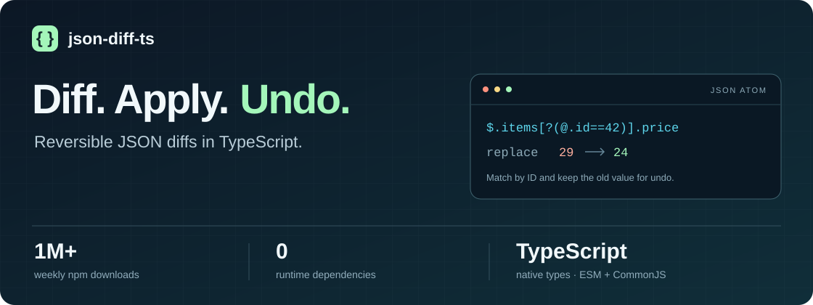

# json-diff-ts



[](https://www.npmjs.com/package/json-diff-ts) [](https://github.com/ltwlf/json-diff-ts/actions/workflows/ci.yml) [](https://codecov.io/gh/ltwlf/json-diff-ts)

Diff, apply, and undo changes to JSON. Match array items by index or by a unique key. Ships with TypeScript types, ESM and CommonJS, and zero runtime dependencies.

## Install

```sh
npm install json-diff-ts
```

## Quick start

```ts
import { diffAtom, applyAtom, revertAtom } from 'json-diff-ts';

const before = { items: [{ id: 42, price: 29 }] };
const after = { items: [{ id: 42, price: 24 }] };
const atom = diffAtom(before, after, { arrayIdentityKeys: { items: 'id' } });

const updated = applyAtom(structuredClone(before), atom); // { items: [{ id: 42, price: 24 }] }
const restored = revertAtom(structuredClone(updated), atom); // { items: [{ id: 42, price: 29 }] }
```

The diff is serializable JSON:

```json
{
  "format": "json-atom",
  "version": 1,
  "operations": [
    { "op": "replace", "path": "$.items[?(@.id==42)].price", "value": 24, "oldValue": 29 }
  ]
}
```

In CommonJS, use `const { diffAtom, applyAtom, revertAtom } = require('json-diff-ts')`.

`applyAtom` and `revertAtom` mutate their input. Clone first to keep the original, and use the returned value to handle root changes. Operations run in order. If an operation throws, earlier operations may already have been applied.

## Diff options

### Array identity

Arrays are compared by index by default. Use `arrayIdentityKeys: { items: 'id' }` to match objects by a unique property, or `arrayIdentityKeys: { tags: '$value' }` to match primitive values. Nested arrays use dot paths, such as `'orders.items'`.

A keyed path targets the same item after a reorder. Keyed diffs do not record pure reorders or restore original insertion positions. Use index-based diffs when exact array order matters. Use consistent types for IDs. The diff producer rejects duplicate IDs and IDs that collide when converted to strings, such as `42` and `'42'` in the same array.

### Select paths

```ts
const atom = diffAtom(before, after, {
  keysToInclude: ['items'],
  keysToSkip: ['items.internal', /\.updatedAt$/],
});
```

`keysToInclude` selects paths and their descendants. Omit it to compare everything. Pass `[]` to produce no changes. `keysToSkip` takes precedence and skips a matching path's entire subtree. Both options use dot-separated paths without array indices or IDs. Regex matching leaves the original regex and its `lastIndex` intact.

Path selection controls what is compared. Whole-object operations still carry the complete value, so use a separate redaction step if you need to remove sensitive fields.

### Undo information

`diffAtom` includes `oldValue` on replacements and removals by default. Pass `{ reversible: false }` to omit undo data. Use JSON-safe input values. A `null` root represents an empty document for root creation and removal.

## JSON Atom API

| Export | Use |
| --- | --- |
| `diffAtom(before, after, options?)` | Compute a JSON Atom with `add`, `remove`, and `replace` operations. |
| `applyAtom(document, atom)` | Apply operations in order, including explicit `move` and `copy`. |
| `revertAtom(document, atom)` | Apply the inverse of a reversible atom. |
| `invertAtom(atom)` | Return the inverse atom without applying it. |
| `validateAtom(value)` | Return `{ valid, errors }` for the atom's structure. Applying it also checks the target document. |
| `squashAtoms(source, atoms, options?)` | Combine a sequence into one diff. |
| `atomMap`, `atomStamp`, `atomGroupBy` | Transform, annotate, or group operations. |
| `atomSpecDict`, `atomExtensions`, `operationSpecDict`, `operationExtensions`, `leafProperty` | Inspect spec fields, extensions, and paths. |

## Python and specification

Python reads and writes the same wire format. Install `json-atom` from PyPI and use `apply_delta` or `revert_delta` from `json_atom`.

- [Python package and examples](https://github.com/ltwlf/json-atom-py)
- [JSON Atom specification](https://github.com/ltwlf/json-atom-format/blob/main/spec/v0.md)
- [TypeScript/Python interoperability checks](https://github.com/ltwlf/json-diff-ts/blob/master/docs/interop.md)

## Migration from v4

The changeset API is still available in v5:

```ts
import { diff, applyChangeset, revertChangeset } from 'json-diff-ts';

const changes = diff(before, after);
const updated = applyChangeset(structuredClone(before), changes);
const restored = revertChangeset(structuredClone(updated), changes);
```

- Use `arrayIdentityKeys` in place of the deprecated `embeddedObjKeys` option. `keysToInclude` and `keysToSkip` work with both diff APIs.
- Use `atomizeChangeset` and `unatomizeChangeset` to flatten and rebuild legacy changesets. `compare`, `comparisonToDict`, and `comparisonToFlatList` expose comparison views.
- `toAtom` converts legacy changesets using string filter values. Recompute with `diffAtom` when you need typed IDs. `fromAtom` cannot convert `move` or `copy`.
- Import from `json-diff-ts` to use the public entry points. To stay on v4, install `json-diff-ts@legacy-v4`.

[Releases](https://github.com/ltwlf/json-diff-ts/releases) · [MIT license](LICENSE) · [Christian Glessner on LinkedIn](https://www.linkedin.com/in/christian-glessner/) · [Support](https://buymeacoffee.com/leitwolf)

Originally based on [diff-json](https://www.npmjs.com/package/diff-json) (MIT).
